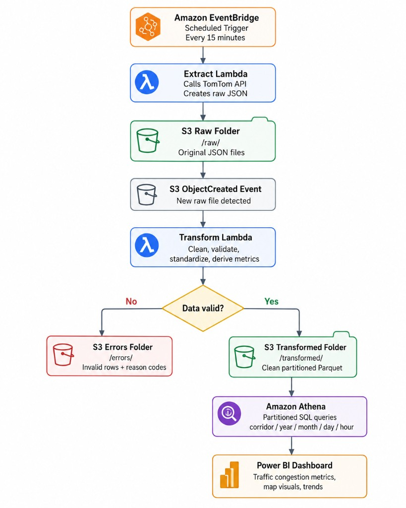
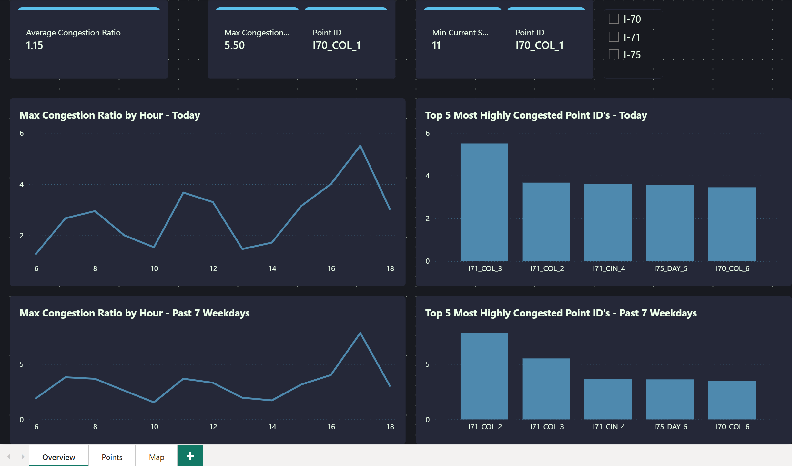
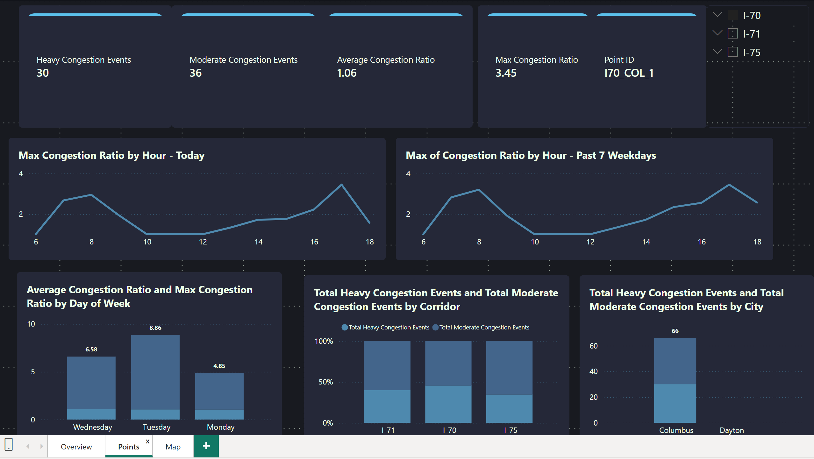
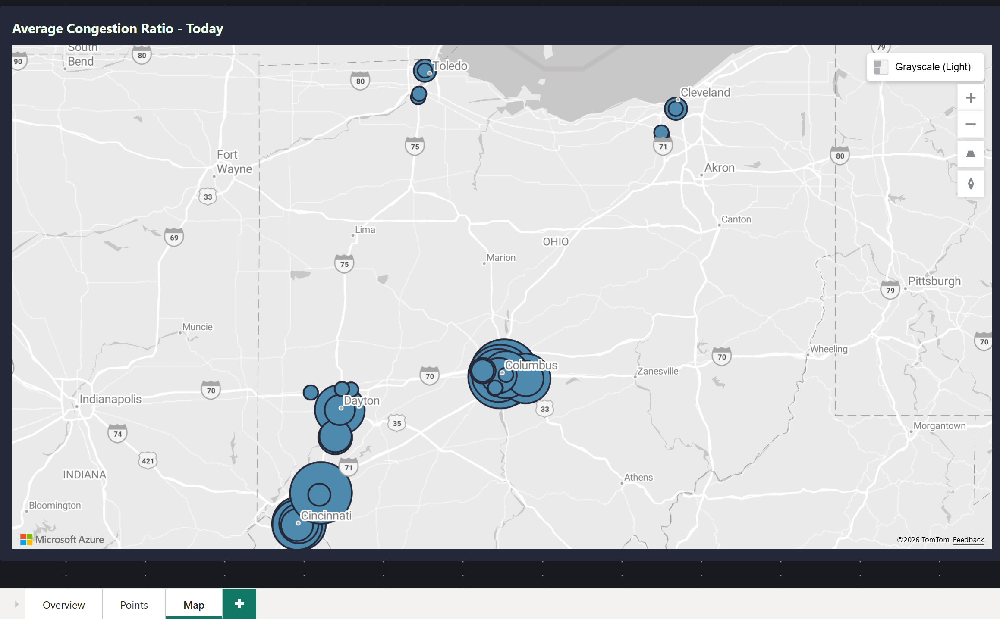

# Traffic Data Pipeline

> Real-time traffic ingestion and analytics pipeline for Ohio interstate corridors, built with Python and AWS.

---

## About This Project

**This project is designed to create an automated congestion tracker for major logistics routes in Ohio. With this data there will be a better understanding of the traffic trends and allow for more intentional routing descisions. All monitoring points were placed near major highway connections as well as the entrances/exits to the major cities. **

| | |
|---|---|
| **Role** | [Solo Developer] |
| **Timeline** | [May 2026 – June 2026] |
| **Status** | [Complete] |

---

## Key Highlights

- Ingests **TomTom Flow Segment Data** for **42 monitoring points** across **I-70, I-71, and I-75** in Cincinnati, Cleveland, Columbus, Dayton, and Toledo every 15 minutes. One file for each corridor containing 14 gps points per corridor is uploaded into an S3 bucket with the raw Tom Tom data + metadata. 
- Once the raw data lands in S3 it triggers the Transform Lambda, which validates the data and prepares it for analytics. Any data that does not meet the requirements is segregated in another S3 folder, with the correct data landing in a Transformed folder. 
- **Serverless AWS architecture** using Lambda, S3, and containerized deployments via ECR. All actions automated using Lambda triggers from Event Bridge and S3. With Athena acting as the main SQL tool. 
- Transforms raw JSON into **partitioned Parquet** with derived congestion metrics and categorical labels
- Supports **downstream SQL analytics** against warehouse-style fact/dimension tables

---

## Architecture

---

## Tech Stack

| Layer | Technologies |
|-------|--------------|
| **Language** | Python 3.x |
| **Data** | Pandas, PyArrow, Parquet, Requests |
| **API** | TomTom Traffic Flow Segment API |
| **Cloud** | AWS Lambda, S3, ECR, IAM, Athena, Event Bridge |
| **DevOps** | Docker, PowerShell deploy scripts, AWS CLI |
| **Analytics** | SQL (fact/dimension model) |
| **Development Environment** | Cursor, ChatGPT-assisted development  |

---

## What It Does

### Extract

- Reads corridor definitions from a configurable CSV of GPS monitoring points
- Calls the TomTom API per point with retry logic and structured logging
- Tags each record with corridor, point ID, and a timestamp ID (`YYYYMMDDHHMM`)
- Writes raw JSON locally or to `s3://traffic-data-pipeline/raw/`

### Transform

- Coerces types and parses datetime fields
- Validates nulls and filters out-of-bounds values
- Computes derived metrics: speed difference, travel time difference, congestion ratio, rush hour flags
- Assigns congestion categories: **Normal**, **Moderate**, **Heavy**, **Closure**
- Outputs Parquet partitioned by `corridor / year / month / day / hour`

### Analyze

All Data is fed from the transformed S3 folder through Athena in which views are created to allow for seamless Power BI queries. Each view either filters todays totals or keeps a running total of the past 7 days, while creating aggregates such as max congestion ratio, heavy/moderate congestion counts, among others.

Once the data is uploaded to Power BI it is seperated into three dashboards (Overview, Points, and Map). Each page can be filtered using a slicer to view specific corridors and points.

#### Overview

#### Points

#### Map

---

## Skills Demonstrated

- REST API integration with error handling and retries
- Data validation and quality checks (nulls, bounds, error file export)
- ETL/ELT pipeline design (batch processing, idempotent file naming)
- Cloud-native serverless architecture on AWS
- Containerized Lambda deployment (Docker + ECR)
- Partitioned data lake storage (S3 + Parquet)
- SQL analytics over a star-schema-style data model

---

## Challenges & Learnings

- **Challenge:** Utilizing AWS services that I had never used before 
  **Solution:** In order order to mitigate some of the fricting for development I chose to build a local model first, before moving into AWS. This allowed for small changes to be made with the core workflow already in place

- **Challenge:** Dealing with the layer size limit for Lambda  
  **Solution:** While it did add a bit more complexity I utilized docker images to bypass the size limit for the Transform Lambda, which was too big with Pandas and Pyarrow. This added another software tool to learn, however it was necessary to keep my final transform files as a parquet.

  **Challenge:** Athena reading too much data when I would run a query
  **Solution:** I had the foresight to partition my final files in s3. However, I did not realize that Athena still needed queries to have the partitions in the where statements or it would try to load the whole folder. To fix this I built my views to be dynamic to select the current date and running weekday day totals.

- **Learning:** - The most important takeaway that I have from creating this project is taking an idea and turning it into actionable steps. While a system can look intimidating from a big picture perspective it can be broken into smaller goals that can be acheived.

- Another key takeaway would be while using Cursor and ChatGPT has helped speed up the progress on my project tremendously, there are still things that need to be verified. For example, using Athena was a great learning experience, but if I were to do this project again or continue improving it I would switch to a more traditional database structure to avoid some of the Athena cost issues that I came across.

---

## Future Improvements

- The biggest limiting factor for this project was staying under the Tom Tom free tier limits. If I had the ability to go beyond those limits I would be able to completely refactor the input portion of my workflow. Instead of using a static spreadsheet I would be able to take user input for specific routes and break them into points that could be ran through the same extract and transform scripts. Or in general I would be able to create a broader range of points and gain further insights.

- I would also like to update the retry logic on my extract script to be more dynamic based on the type of error that I receive.

---
