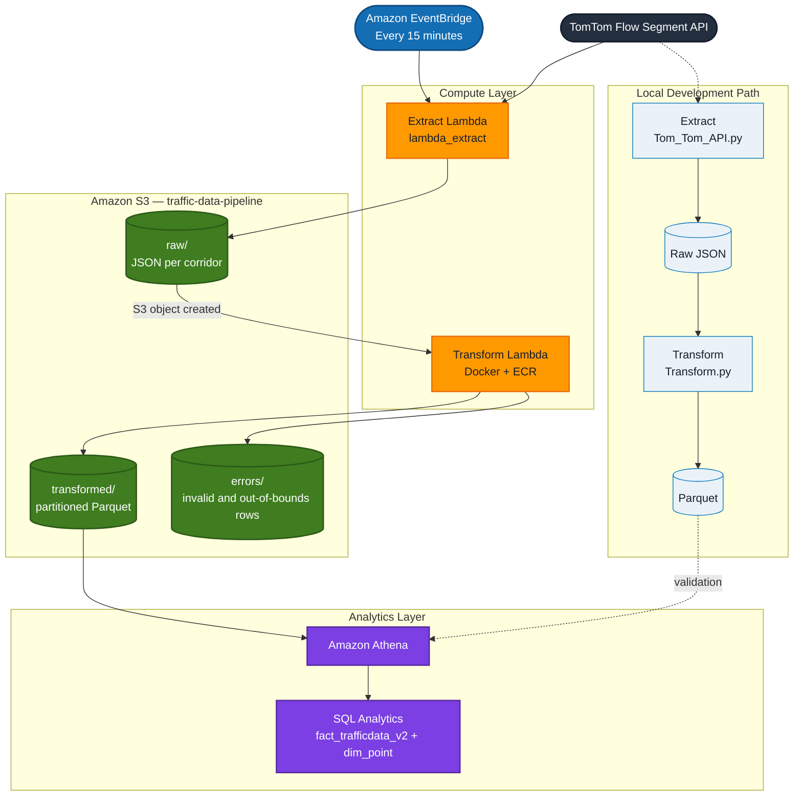

# Traffic Data Pipeline

> Real-time traffic ingestion and analytics pipeline for Ohio interstate corridors, built with Python and AWS.

[](https://www.python.org/)
[](https://aws.amazon.com/)
[](https://developer.tomtom.com/)

---

## About This Project

**This project is designed to create an automated congestion tracker for major logistics routes in Ohio. With this data there will be a better understanding of the traffic trends and allow for more intentional routing descisions. **


| | |
|---|---|
| **Role** | [Solo Developer] |
| **Timeline** | [May 2026 – Present] |
| **Status** | [In Progress / Production / Portfolio Demo] |
| **Repository** | [Public GitHub URL if applicable] |

---

## Key Highlights

- Ingests **TomTom Flow Segment Data** for **42 monitoring points** across **I-70, I-71, and I-75** in Cincinnati, Cleveland, Columbus, Dayton, and Toledo every 15 minutes. One file for each corridor containing 14 gps points per corridor is uploaded into an S3 bucket with the raw Tom Tom data + metadata. 
- Once the raw data lands in S3 it triggers the Transform Lambda, which validates the data and prepares it for analytics. Any data that does not meet the requirements is segregated in another S3 folder, with the correct data landing in a Transformed folder. 
- **Serverless AWS architecture** using Lambda, S3, and containerized deployments via ECR. All actions automated using Lambda triggers from Event Bridge and S3. With Athena acting as the main SQL tool. 
- Transforms raw JSON into **partitioned Parquet** with derived congestion metrics and categorical labels
- Supports **downstream SQL analytics** against warehouse-style fact/dimension tables

---

## Architecture



**Production path:** EventBridge invokes Extract Lambda on a 15-minute schedule. Raw JSON lands in S3 `raw/`, which triggers Transform Lambda. Valid records are written to partitioned Parquet in `transformed/`; failed validation rows go to `errors/`. Athena queries the curated data using SQL scripts.

**Local path:** The same extract and transform logic runs from `Python_Scripts/` for development and validation before deployment.

---

## Tech Stack

| Layer | Technologies |
|-------|--------------|
| **Language** | Python 3.x |
| **Data** | Pandas, PyArrow, Parquet |
| **API** | TomTom Traffic Flow Segment API, `requests` |
| **Cloud** | AWS Lambda, S3, ECR, IAM |
| **DevOps** | Docker, PowerShell deploy scripts, AWS CLI |
| **Analytics** | SQL (fact/dimension model) |

---

## What It Does

### Extract

- Reads corridor definitions from a configurable CSV of GPS monitoring points
- Calls the TomTom API per point with retry logic and structured logging
- Tags each record with corridor, point ID, and a timestamp ID (`YYYYMMDDHHMM`)
- Writes raw JSON locally or to `s3://traffic-data-pipeline/raw/`

### Transform

- Coerces types and parses datetime fields
- Validates nulls and filters out-of-bounds values (speed, travel time, confidence)
- Computes derived metrics: speed difference, travel time difference, congestion ratio, rush hour flags
- Assigns congestion categories: **Normal**, **Moderate**, **Heavy**, **Closure**
- Outputs Parquet partitioned by `corridor / year / month / day / hour`

| Congestion Category | Rule |
|---------------------|------|
| **Closure** | `Road_Closure == true` |
| **Heavy** | `Congestion_Ratio >= 1.5` |
| **Moderate** | `Congestion_Ratio >= 1.2` |
| **Normal** | All other cases |

### Analyze

Example query — highest-congestion monitoring points:

```sql
SELECT DISTINCT d.point_id,
       MAX(congestion_ratio) AS highest_congestion_ratio,
       d.point_type, d.corridor, d.city, d.direction
FROM fact_trafficdata_v2 f
JOIN dim_point d ON f.point_id = d.point_id
GROUP BY d.point_id, d.point_type, d.corridor, d.city, d.direction
ORDER BY highest_congestion_ratio DESC
LIMIT 10;
```

---

## Sample Output

**[Add a screenshot, sample chart, or table here.]**

| Corridor | City | Congestion Category | Congestion Ratio |
|----------|------|---------------------|------------------|
| I-71 | Cincinnati | Heavy | 1.62 |
| I-75 | Dayton | Moderate | 1.28 |
| I-70 | Columbus | Normal | 0.94 |

*Replace with real results from your pipeline or warehouse.*

---

## Project Structure

```
Traffic-Project/
├── Python_Scripts/              # Local ETL pipeline
├── AWS_Scripts/
│   ├── lambda_extract/          # API extraction → S3
│   ├── lambda_transform/        # S3-triggered transform → Parquet
│   └── SQL Scripts/             # Analytics queries
├── Test Scripts/                # API and S3 smoke tests
└── Data/                        # Local raw, transformed, archive, errors
```

---

## Skills Demonstrated

- REST API integration with error handling and retries
- Data validation and quality checks (nulls, bounds, error file export)
- ETL/ELT pipeline design (batch processing, idempotent file naming)
- Cloud-native serverless architecture on AWS
- Containerized Lambda deployment (Docker + ECR)
- Partitioned data lake storage (S3 + Parquet)
- SQL analytics over a star-schema-style data model

---

## Getting Started

### Prerequisites

- Python 3.x
- [TomTom Developer API key](https://developer.tomtom.com/)
- AWS CLI + Docker (for Lambda deployment)

### Environment Variables

```env
# Local (.env in Python_Scripts/)
TomTom_API_Key=your_key_here

# AWS Extract Lambda
TomTom_API_Key=your_key_here
Flow_Segment_URL=https://api.tomtom.com/traffic/services/4/flowSegmentData/absolute/10/json?

# AWS Transform Lambda
bucket_name=traffic-data-pipeline
s3_folder_transformed=transformed
s3_folder_errors=errors
```

> `.env` files are gitignored. Do not commit API keys.

### Run Locally

```powershell
cd Python_Scripts
python Main.py
```

### Deploy Transform Lambda

```powershell
cd AWS_Scripts/lambda_transform
.\deploy-transform-lambda.ps1
```

---

## Challenges & Learnings

**[Fill in 2–4 bullets — recruiters and hiring managers read this section.]**

- **Challenge:** [What was hard — e.g. handling API rate limits or inconsistent responses]  
  **Solution:** [What you did — e.g. retry logic, validation layer, error exports to S3]

- **Challenge:** [e.g. packaging Pandas/PyArrow for Lambda]  
  **Solution:** [e.g. Docker-based Lambda with ECR deployment script]

- **Learning:** [e.g. partitioning Parquet by corridor and time improved query performance for downstream analytics]

---

## Future Improvements

- [ ] [e.g. EventBridge schedule for automated extraction]
- [ ] [e.g. Glue/Redshift load automation]
- [ ] [e.g. Dashboard in QuickSight or Grafana]
- [ ] [e.g. CI/CD pipeline for Lambda deployments]
- [ ] [e.g. Unit tests for transform functions]

---

## Contact

**[Your Name]**  
[LinkedIn](https://linkedin.com/in/your-profile) · [Portfolio](https://your-portfolio.com) · [Email](mailto:you@example.com)

---

## License

[MIT / Unlicensed / All Rights Reserved — your choice]
